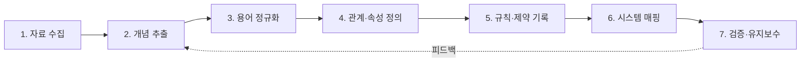
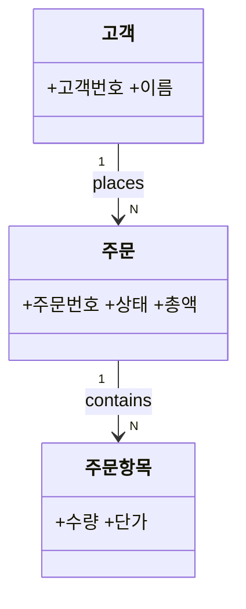

# 레거시 시스템 온톨로지 구성 가이드

특정 시스템에 종속되지 않는 방법론과 템플릿이다. 레거시 시스템의 DB·코드·문서에 흩어진 지식을
"개념(Class) · 관계(Relation) · 속성(Attribute) · 규칙(Rule)"으로 정리해 사람과 도구(LLM 포함)가
같은 용어로 시스템을 이해하게 하는 것이 목적이다.

## 1. 목적과 범위 정하기

온톨로지를 만들기 전에 아래 세 가지를 먼저 적는다. 이것이 없으면 범위가 끝없이 커진다.

| 항목 | 질문 | 예시 |
|---|---|---|
| 용도 | 누가 무엇을 하려고 쓰는가? | 마이그레이션 영향 분석, 신규 개발자 온보딩, LLM 질의응답 |
| 범위 | 어느 업무 영역·모듈까지 다루는가? | 주문·결제 도메인만 |
| 역량 질문(Competency Questions) | 온톨로지가 답해야 할 질문 | "주문이 취소되면 어떤 테이블·배치가 영향을 받는가?" |

역량 질문은 5~15개 정도로 두고, 완성 후 이 질문에 답할 수 있는지로 검증한다.

## 2. 진행 절차



### 1단계. 자료 수집 (인벤토리)
| 출처 | 얻는 것 | 방법 |
|---|---|---|
| DB 스키마 | 테이블=후보 클래스, FK=후보 관계, 컬럼=후보 속성 | `INFORMATION_SCHEMA`, ERD 역공학 |
| 코드 | 도메인 모델, 서비스 간 호출, 상태 전이 | 클래스·enum·상태 코드 검색 |
| 배치/스케줄러/인터페이스 | 데이터 흐름, 외부 시스템 연동 | 잡 정의, 연동 명세 |
| 문서·화면 | 업무 용어, 화면 항목명 | 기획서, 매뉴얼, 화면 캡처 |
| 사람 | 문서에 없는 암묵지, 예외 규칙 | 담당자 인터뷰 |

### 2단계. 개념 추출
- 명사 → 클래스 후보, 동사 → 관계 후보, 형용사·수치 → 속성 후보로 분류한다.
- 테이블 1개 = 클래스 1개로 기계적으로 옮기지 않는다. 레거시에는 한 테이블에 여러 개념이 섞이거나(예: `TB_CODE`), 한 개념이 여러 테이블로 쪼개진 경우가 많다.
- 코드성 테이블·상태값은 별도 클래스(또는 열거형)로 분리한다.

### 3단계. 용어 정규화 (용어집)
레거시의 가장 큰 문제는 같은 개념의 다른 이름, 다른 개념의 같은 이름이다.

| 표준 용어 | 정의 | 동의어(레거시 표기) | 사용 위치 |
|---|---|---|---|
| 고객 | 서비스 계약 주체 | CUST, 회원, USER_MST | DB, 화면 |
| 주문 | 고객의 구매 요청 1건 | ORD, 오더, T_ORDER | DB, 배치 |

### 4단계. 관계·속성 정의
- 관계는 방향과 카디널리티를 함께 적는다 (`고객 1 —places→ N 주문`).
- 관계 이름은 동사로, 역관계도 적는다 (`places` / `placedBy`).
- 속성에는 타입, 필수 여부, 코드 도메인을 적는다.
- 상속(is-a)과 포함(part-of)을 구분한다.

### 5단계. 규칙·제약 기록
코드와 SQL 안에 묻힌 업무 규칙을 꺼내 문장으로 적고 출처를 남긴다.
- 불변식: "취소된 주문은 결제 상태를 변경할 수 없다"
- 상태 전이: `접수 → 결제완료 → 출고 → 배송완료` (역방향 불가)
- 파생 규칙: "배송완료 7일 후 구매확정으로 자동 전환 (배치 `BAT_CONFIRM`)"

### 6단계. 시스템 매핑
온톨로지의 각 요소가 레거시의 어디에 구현돼 있는지 연결한다. 마이그레이션·영향 분석에서 가장 가치가 큰 부분이다.

| 온톨로지 요소 | 종류 | DB | 코드 | 배치/인터페이스 | 비고 |
|---|---|---|---|---|---|
| 주문 | Class | `T_ORDER` | `OrderService` | `BAT_CONFIRM` | |
| 주문.상태 | Attribute | `T_ORDER.STAT_CD` | `OrderStatus` enum | | 코드값 불일치 있음 |

### 7단계. 검증·유지보수
- 1단계에서 정한 역량 질문마다 "온톨로지만으로 답할 수 있다 / 없다"를 표시하고, 없다면 빠진 요소를 보강한다.
- 담당자 리뷰에서 용어 정의와 규칙의 오류를 잡는다.
- 변경 이력(버전, 변경자, 사유)을 남긴다. 시스템이 바뀔 때마다 갱신하지 않으면 곧 쓸모없어진다.

## 3. 산출물 템플릿

### 3.1 클래스 카드
```
클래스: 주문 (Order)
정의: 고객이 상품 구매를 요청한 1건
상위 클래스: 거래 (Transaction)
속성: 주문번호(string, 필수), 주문일시(datetime), 상태(OrderStatus), 총액(decimal)
관계: placedBy → 고객 (N:1), contains → 주문항목 (1:N)
규칙: R-001, R-002
매핑: DB T_ORDER / 코드 OrderService
출처: ERD v3, 담당자 인터뷰(2026-xx-xx)
상태: 검증됨 / 검토필요
```

### 3.2 관계 표
| 주체 | 관계 | 대상 | 카디널리티 | 역관계 | 출처 |
|---|---|---|---|---|---|
| 고객 | places | 주문 | 1:N | placedBy | FK `T_ORDER.CUST_ID` |

### 3.3 규칙 표
| ID | 규칙 | 유형 | 출처 | 확인 |
|---|---|---|---|---|
| R-001 | 취소된 주문은 결제 상태를 변경할 수 없다 | 불변식 | `OrderService.cs`, 인터뷰 | ☐ |

### 3.4 개념 다이어그램 (Mermaid)


## 4. 레거시에서 자주 만나는 함정

| 함정 | 대응 |
|---|---|
| 한 컬럼에 여러 의미 (플래그 재사용) | 의미별로 속성을 분리하고 매핑 표에 경고를 남긴다 |
| 매직 넘버·코드값 | 코드 테이블을 클래스/열거형으로 승격하고 값마다 정의를 적는다 |
| 문서와 실제 동작 불일치 | 코드·데이터를 기준으로 삼고 불일치는 "검토필요"로 표시한다 |
| 죽은 테이블·컬럼 | 사용 여부를 확인하고 "폐기 후보"로 분류한다. 삭제는 온톨로지의 몫이 아니다 |
| 담당자만 아는 예외 규칙 | 인터뷰에서 "예외가 언제 생기나요?"를 반드시 묻는다 |
| 처음부터 완벽을 추구 | 역량 질문 범위 안에서 먼저 완성하고 점진적으로 확장한다 |

## 5. 표현 형식 선택

| 형식 | 적합한 경우 |
|---|---|
| Markdown 표 + Mermaid (이 문서 방식) | 소규모, 사람이 읽고 리뷰하는 것이 우선, 저장소에서 버전 관리 |
| OWL/Turtle (`.ttl`) | 추론기·SPARQL 질의가 필요할 때, Protégé 편집 |
| 그래프 DB (Neo4j 등) | 영향 분석처럼 관계 탐색 질의가 많을 때 |

처음에는 Markdown으로 시작해 역량 질문이 안정되면 필요에 따라 Turtle 등으로 변환하는 것을 권장한다.

## 6. 체크리스트

- [ ] 용도·범위·역량 질문 작성
- [ ] 자료 인벤토리 작성 (DB/코드/배치/문서/담당자)
- [ ] 개념 후보 추출 및 용어집 작성
- [ ] 클래스·관계·속성 정의
- [ ] 업무 규칙 문서화 (출처 포함)
- [ ] 시스템 매핑 표 작성
- [ ] 역량 질문으로 검증, 담당자 리뷰
- [ ] 버전·변경 이력 관리 체계 마련
